<div align="center">


# Vital UI

**A token-first Svelte 5 component library.**
103 composable components, one design system, light and dark, zero CSS files to write.

[](https://github.com/mirabelle-labs/vital-ui/actions/workflows/ci.yml)
[](https://www.npmjs.com/package/@mirabelle-labs/vital-ui)


[**Live demo**](https://vital-ui.matteow.com) · [npm](https://www.npmjs.com/package/@mirabelle-labs/vital-ui) · [Components](#components) · [Design tokens](#design-tokens) · [Helpers](#helpers)

<br />

<table>
  <tr>
    <td>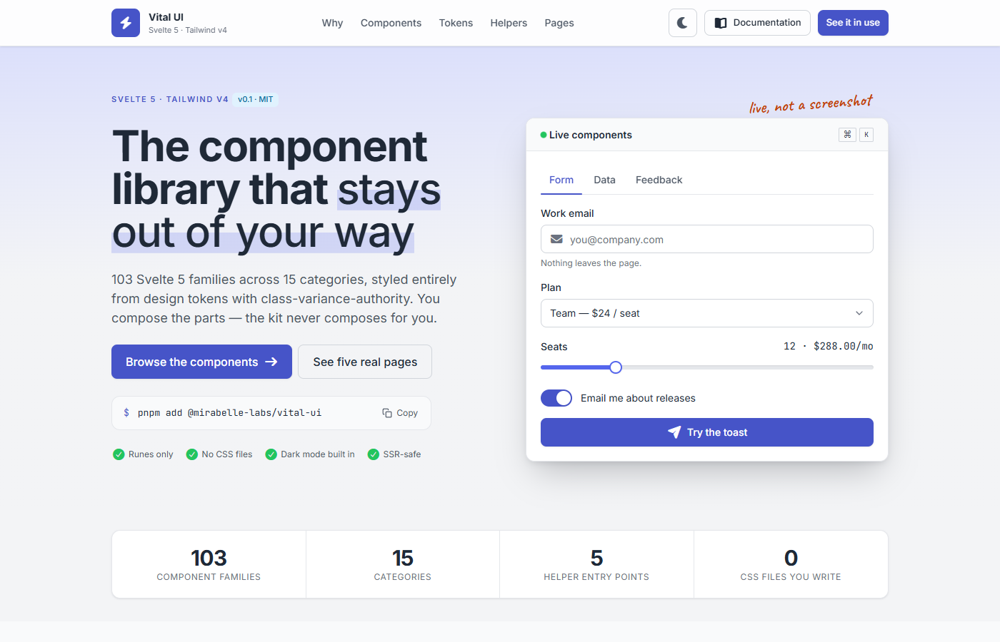</td>
    <td>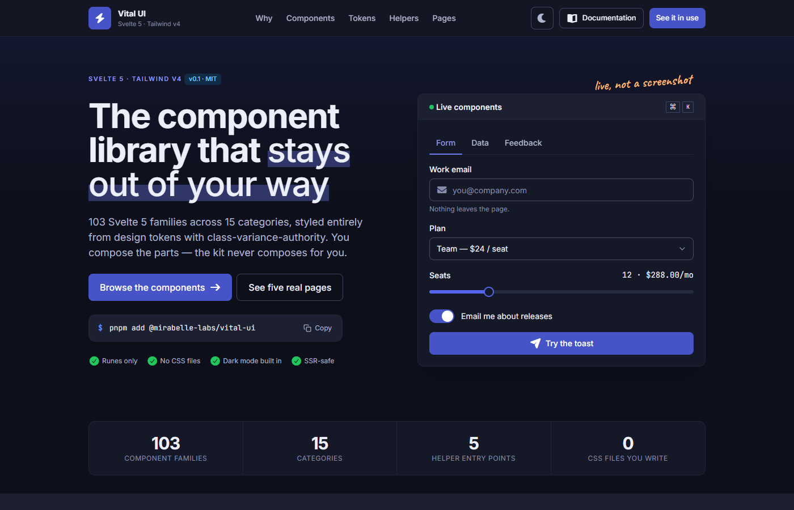</td>
  </tr>
</table>

</div>

---

## Why Vital UI

Most component libraries give you a finished look and a pile of overrides. Vital UI gives you a **design system** and components that are nothing but that system applied.

- **Tokens, not values.** Colours, radius, elevation, layers, motion and focus come from `src/lib/tokens/`. A component writes `bg-surface`, `rounded-control`, `shadow-overlay`, `focus-ring` — never a hex, never a one-off pixel.
- **The parent composes the children.** No `<Menu items={…}>` with a config object: you assemble `Menu` + `MenuItem`, `Card` + `CardHeader` / `CardBody` / `CardFooter`, `Tabs` + `TabList` / `Tab` / `TabPanel`.
- **Every visual axis is a typed variant.** One `variants.ts` per family owns all styling and every default (`class-variance-authority`); every `*Variants` object is exported so you can reuse a recipe outside the component.
- **Two themes, one class.** Each semantic token is redefined under `[data-theme='dark']`, so a component writes one class and both themes are covered.
- **No CSS files to write.** Tailwind utilities only. Components never import an icon: the parent passes it in, and `<Icon>` renders Font Awesome glyphs if you add that stylesheet.
- **The logic around the UI is included.** Typed, tested helpers for lists, forms, overlays, async actions, formatting and validation, on their own entry points so a Button never pulls them in.

## Contents

- [Screens](#screens)
- [Install](#install)
- [Quick start](#quick-start)
- [Components](#components)
- [Design tokens](#design-tokens)
- [Theming](#theming)
- [Helpers](#helpers)
- [The demo site](#the-demo-site)
- [Project structure](#project-structure)
- [Development](#development)
- [Quality gates](#quality-gates)
- [Working with Claude Code](#working-with-claude-code)
- [License](#license)

## Screens

Every screen below is the library itself — the demo site and its pages are built from nothing else.

### Playground

Each component has a preview canvas, a props panel generated from its variants, and the markup and imports derived from the demo — never written by hand.

<table>
  <tr>
    <td>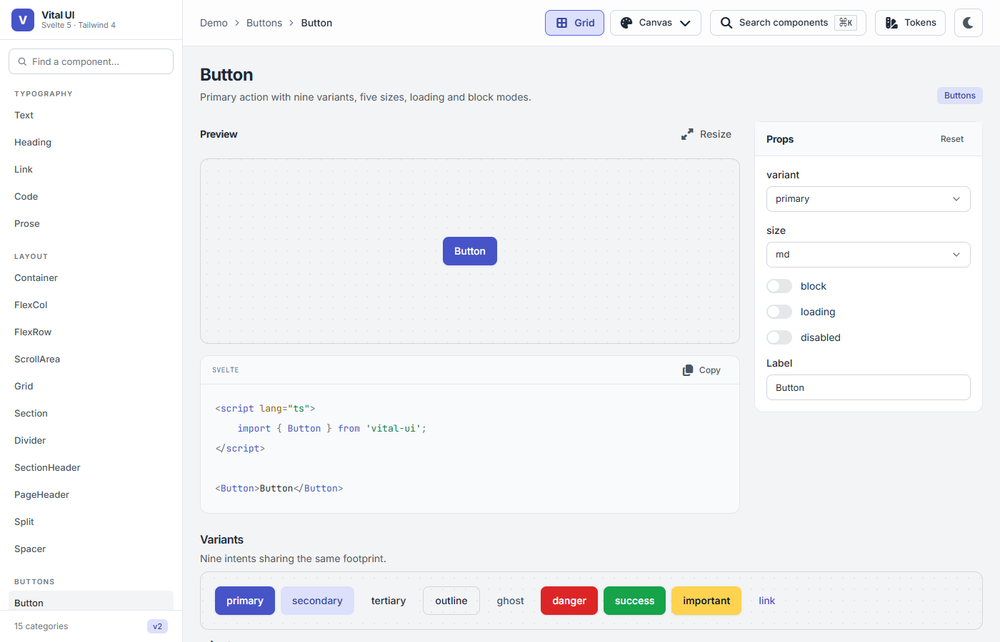</td>
    <td>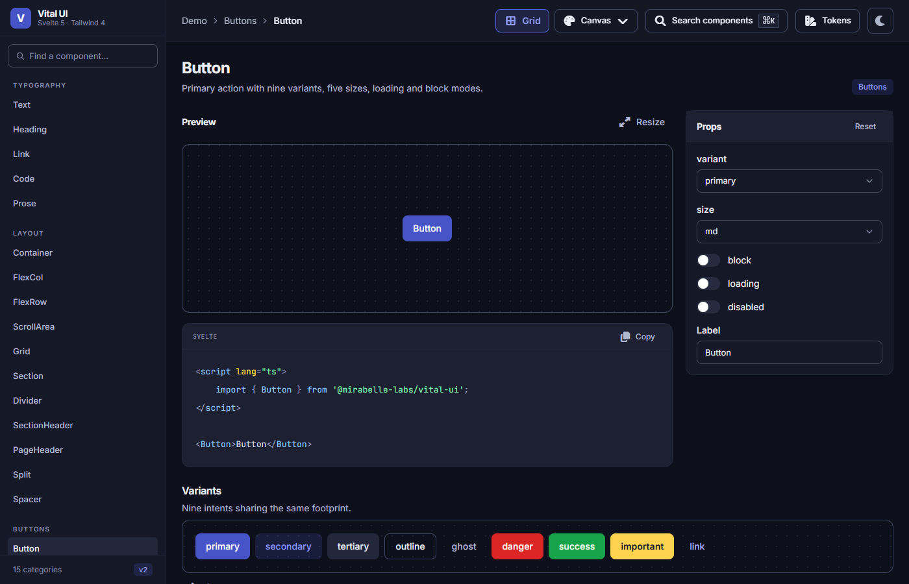</td>
  </tr>
</table>

### Design tokens

`/demo/tokens` lists every token straight from the stylesheets: colour roles, palette, spacing, radius, elevation, layers and motion.

<table>
  <tr>
    <td>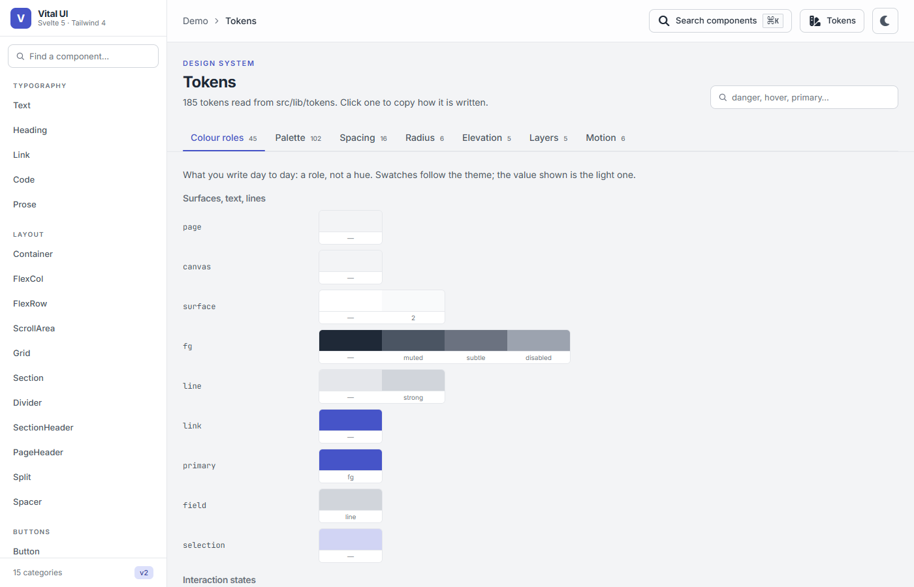</td>
    <td>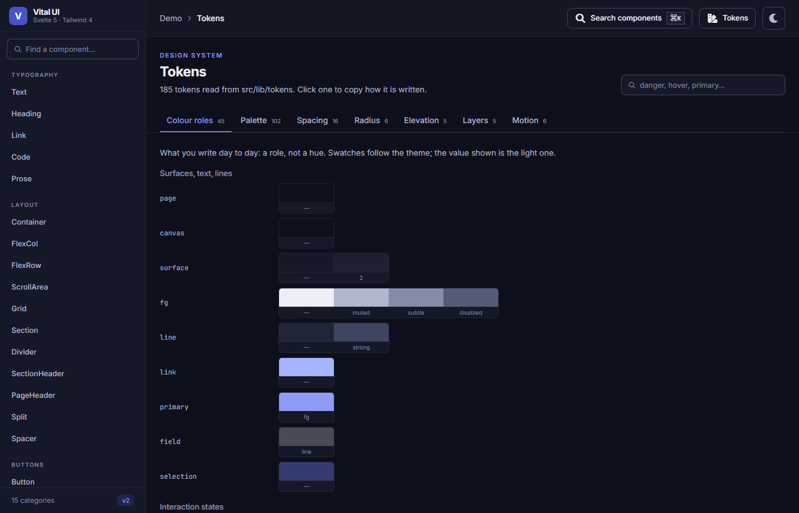</td>
  </tr>
</table>

### Real pages

Four complete pages prove the kit survives dense, stateful screens.

| Client portal                                                                     | SaaS landing                                                                    |
| --------------------------------------------------------------------------------- | ------------------------------------------------------------------------------- |
| 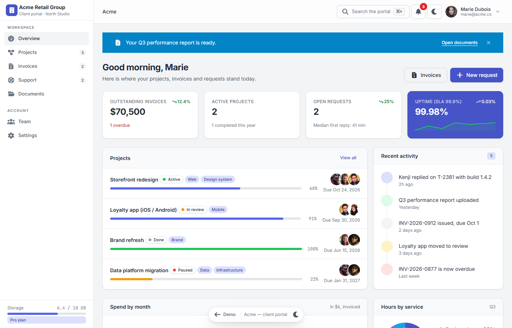 | 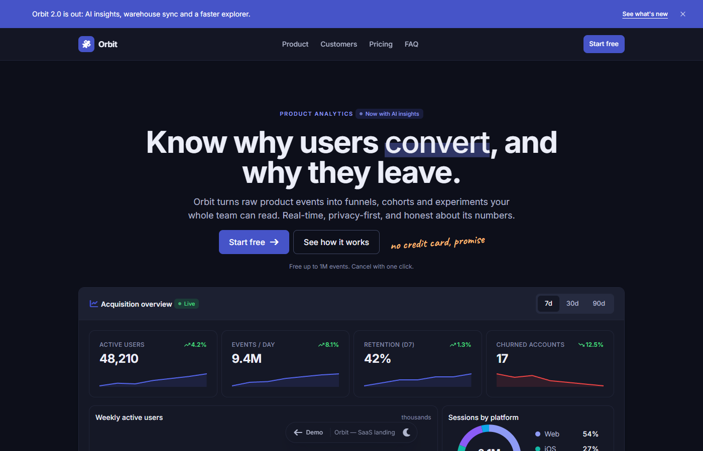      |
| **Shop** — listing, product, cart drawer, four-step checkout                      | **Kubernetes console** — sidebar of nodes, gauges, YAML                         |
| 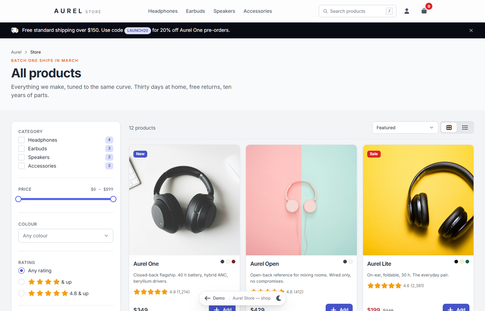              | 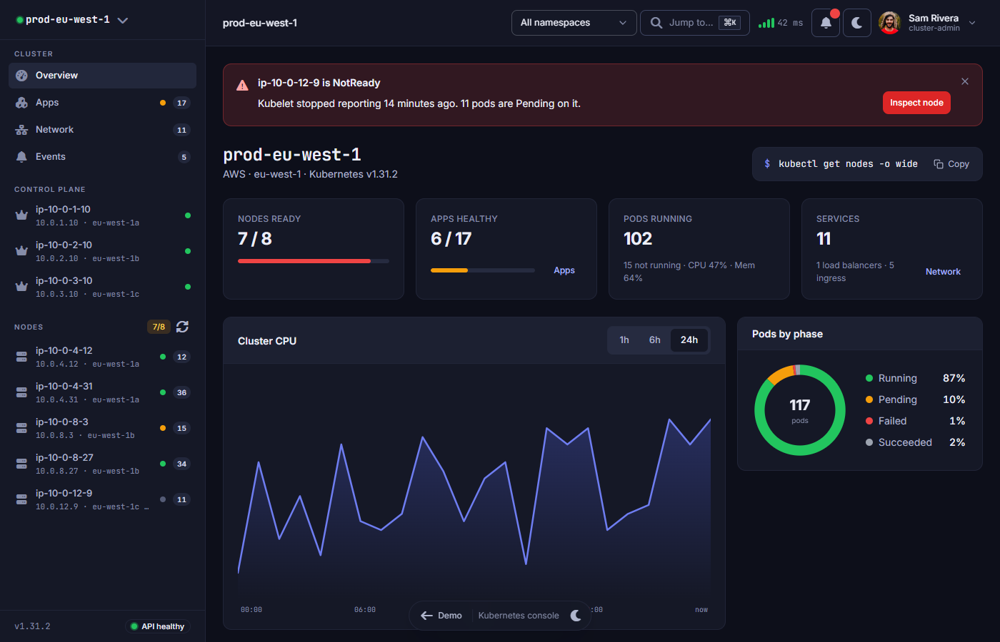 |

### Gallery and helpers

<table>
  <tr>
    <td>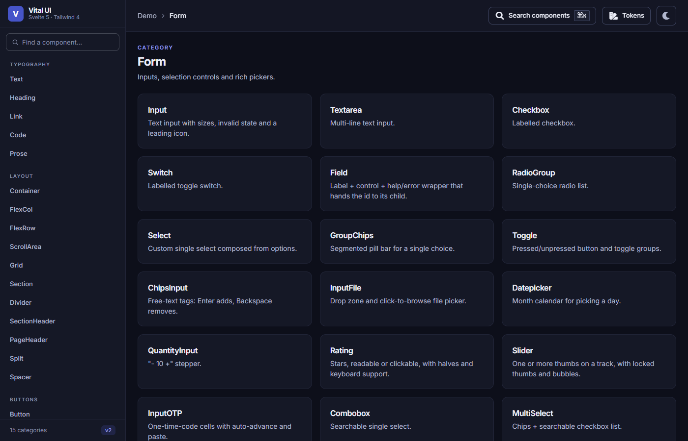</td>
    <td>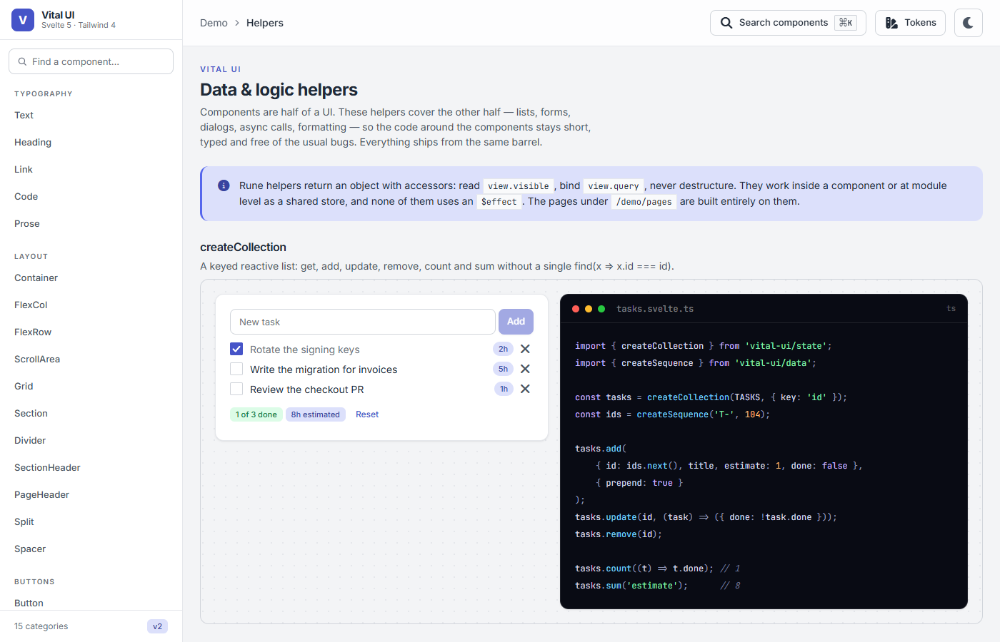</td>
  </tr>
</table>

## Install

```bash
pnpm add @mirabelle-labs/vital-ui
```

Peer dependencies: `svelte@^5` and `tailwindcss@^4`. The kit itself depends on `class-variance-authority`, `clsx` and `tailwind-merge`. `<Icon>` needs Font Awesome in your own app (`pnpm add @fortawesome/fontawesome-free`); skip it if you never use `<Icon>`.

Load the design system once, after Tailwind:

```css
/* app.css */
@import 'tailwindcss';
@import '@fortawesome/fontawesome-free/css/all.css'; /* only if you use <Icon> */
@import '@mirabelle-labs/vital-ui/styles';
```

`@mirabelle-labs/vital-ui/styles` brings the tokens, the fonts (Inter, JetBrains Mono, Caveat) and the base layer. Dark mode is `data-theme="dark"` on `<html>` or on any subtree.

## Quick start

```svelte
<script lang="ts">
	import { Button, Card, CardBody, Field, Input } from '@mirabelle-labs/vital-ui';
</script>

<Card>
	<CardBody>
		<Field label="Email" help="We never share it.">
			{#snippet children(id)}<Input {id} type="email" placeholder="you@company.com" />{/snippet}
		</Field>
		<Button variant="primary" size="lg">Save</Button>
	</CardBody>
</Card>
```

A few conventions worth knowing before you start:

```svelte
<!-- Toasts are objects, and they speak to the person who just acted -->
<script>
	import { toast } from '@mirabelle-labs/vital-ui';
	toast.success({ title: 'You are on the list', description: 'A 10% code is on its way.' });
</script>

<!-- Props are typed from the variants; defaults live in variants.ts, not in the component -->
<Button variant="outline" size="sm" loading>Syncing</Button>

<!-- `class` is always accepted and always wins (tailwind-merge) -->
<Card class="max-w-container-lg">…</Card>

<!-- Set variant / size / colour defaults for a whole subtree -->
<VariantProvider size="sm" density="compact">
	<Button>Small</Button>
	<Badge>Small</Badge>
</VariantProvider>
```

## Components

103 families in 15 categories. Each category folder has its own README listing every family and its parts.

| Category                                    | Families | What it covers                                                           |
| ------------------------------------------- | -------: | ------------------------------------------------------------------------ |
| [Typography](src/lib/components/typography) |        5 | Text, headings, links, code and long-form prose                          |
| [Layout](src/lib/components/layout)         |       11 | Containers, stacks, grids, page bands and sections                       |
| [Buttons](src/lib/components/button)        |        6 | Actions, icon buttons, groups, split buttons, icon tiles                 |
| [Badges](src/lib/components/badge)          |        2 | Status labels and removable tags                                         |
| [Feedback](src/lib/components/feedback)     |       11 | Alerts, banners, callouts, progress, spinners, status indicators         |
| [Form](src/lib/components/form)             |       20 | Inputs, selects, pickers, sliders, OTP, file drop, transfer list         |
| [Surface](src/lib/components/surface)       |        2 | Cards composed from header, bars, body and footer                        |
| [Media](src/lib/components/media)           |        3 | Images, avatars and anchored badges                                      |
| [Data](src/lib/components/data)             |        8 | Tables, KPI tiles, lists, timelines, sparklines                          |
| [Charts](src/lib/components/charts)         |        4 | Dependency-free SVG charts                                               |
| [Navigation](src/lib/components/nav)        |        6 | Tabs, accordions, steppers, breadcrumbs, pagination                      |
| [Overlay](src/lib/components/overlay)       |        9 | Tooltips, popovers, dialogs, drawers, menus, toasts, command palette     |
| [App shell](src/lib/components/app)         |        5 | App frame, sidebar, navbar, user menu, footer                            |
| [Editorial](src/lib/components/editorial)   |        6 | Eyebrows, highlights, handwritten notes, code blocks and windows         |
| [Misc](src/lib/components/misc)             |        5 | Icons, keyboard hints, toolbars, polymorphic primitive, variant provider |

### Which message component?

Four exist because they answer four different questions. Pick by where the message lives, not by how loud it is.

| Component | Lives                                         | Dismissible | For                                        |
| --------- | --------------------------------------------- | ----------- | ------------------------------------------ |
| `Alert`   | in the content flow, next to what it concerns | no          | the state of the thing you are looking at  |
| `Banner`  | top of a page or shell, full width            | yes         | something global and temporary             |
| `Callout` | inside prose or a card, as an aside           | no          | a note that helps but does not warn        |
| `Toast`   | floating, over everything, on a timer         | itself      | the result of an action the user just took |

### Shared behaviour

Two Svelte actions carry the logic every floating component needs, and are exported for your own:

| Action            | Does                                                            | Used by                                                |
| ----------------- | --------------------------------------------------------------- | ------------------------------------------------------ |
| `use:dismissable` | closes on outside click and Escape                              | Popover, Menu, UserMenu, Select, Combobox, MultiSelect |
| `use:overlay`     | Escape, scroll lock, focus trap, focus restore; nests correctly | Dialog, AlertDialog, Drawer, CommandPalette            |

## Design tokens

Everything visual is a token under [`src/lib/tokens`](src/lib/tokens), split by concern and imported in one order.

| Axis         | Tokens                                                                                                                                                                                     | Utilities                                          |
| ------------ | ------------------------------------------------------------------------------------------------------------------------------------------------------------------------------------------ | -------------------------------------------------- |
| Colour roles | `page`, `surface`, `surface-2`, `fg` (+ `muted` / `subtle` / `disabled`), `line` / `line-strong`, `field-line`, `link`, `primary-fg`, `track`, `inverse`, `night`, `backdrop`, `selection` | `bg-surface`, `text-fg-muted`, `border-field-line` |
| Soft tones   | `{primary,success,warning,danger,info,neutral}-soft` + `-hover` / `-line` / `-fg`                                                                                                          | `bg-danger-soft text-danger-soft-fg`               |
| Palette      | primary (indigo), secondary (teal), gray, success, warning, danger, info, important, violet, orange                                                                                        | `bg-primary-600`                                   |
| Spacing      | named scale `4xs`…`4xl`, plus `control-xs`…`xl` for interactive heights                                                                                                                    | `px-md`, `gap-2xs`, `h-control-md`                 |
| Radius       | `inline` 6 · `control` 8 · `surface` 12 · `overlay` 16 · `pill`                                                                                                                            | `rounded-control`                                  |
| Elevation    | `raised` · `lifted` · `overlay` · `floating` · `sunken`                                                                                                                                    | `shadow-overlay`                                   |
| Layers       | `raised` 10 · `nav` 30 · `dropdown` 40 · `overlay` 50 · `toast` 60                                                                                                                         | `z-dropdown`                                       |
| Motion       | `fast` 120 ms · `base` 180 ms · `slow` 320 ms, three easings, reduced-motion aware                                                                                                         | `duration-base`                                    |
| Focus        | one ring for the kit, plus a field variant for bordered controls                                                                                                                           | `focus-ring`, `focus-field`                        |

Seven of those axes are enforced by lint (`no-restricted-syntax` in `eslint.config.js`), so a `shadow-sm` or a `z-40` fails the build.

## Theming

- **Dark mode** — `data-theme="dark"` on any root. The dark palette is an indigo-tinted ink rather than a grey inversion, so the page, the cards and the brand colour read as one family. The theme store of the demo persists the choice and an inline script in `app.html` applies it before hydration, so there is no flash.
- **Density** — `data-density="compact"` on any root shortens every `h-control-*`. Components need no change.
- **Right-to-left** — components use logical properties only (`ps-`, `me-`, `start-`, `text-end`, `rounded-s-`). The kit works in RTL as is.
- **Defaults for a subtree** — `<VariantProvider variant size color density>` sets defaults for `Button`, `IconButton`, `Badge`, `Tag` and `IconBlock` below it.
- **Make it yours** — restyle the whole kit by editing the token files, or override a token on any subtree with a CSS variable. Components never hard-code a colour.

## Helpers

Components are half of a UI; the other half is the data and logic around them. Helpers live behind **their own entry points**, are typed, tested and SSR-safe.

| Entry point                           | What it holds                                                                                    |
| ------------------------------------- | ------------------------------------------------------------------------------------------------ |
| `@mirabelle-labs/vital-ui`            | every component, `cn()`, `VariantProvider`, `dismissable`, `overlay`                             |
| `@mirabelle-labs/vital-ui/state`      | `createCollection`, `createOverlay`, `createForm`, `createListView`, `createAction`, `createLog` |
| `@mirabelle-labs/vital-ui/validation` | `required`, `email`, `port`, `dns1123`, `compose`, `validateWith` and more rules                 |
| `@mirabelle-labs/vital-ui/format`     | `money`, `compact`, `percent`, `bytes`, `plural`, `age`, `relativeTime`, `shortDate`             |
| `@mirabelle-labs/vital-ui/data`       | `sumBy`, `countBy`, `groupBy`, `tally`, `sortBy`, `toneMap`, `thresholdTone`, `createSequence`   |
| `@mirabelle-labs/vital-ui/timing`     | `delay`, `debounce`, `throttle`, `after`, `every`, `isBrowser`                                   |
| `@mirabelle-labs/vital-ui/code`       | `highlight` and the `Highlighter` contract behind `CodeBlock`                                    |

Rune helpers return objects with accessors: read `view.visible`, bind `view.query`, never destructure. They work at module level (a shared store) and inside a component. A list with search, filters, pagination, a detail drawer and a validated form:

```svelte
<script lang="ts">
	import { SearchInput, GroupChips, Pagination, Tr } from '@mirabelle-labs/vital-ui';
	import { Drawer, Field, Input, Button, toast } from '@mirabelle-labs/vital-ui';
	import { createListView, createOverlay, createForm } from '@mirabelle-labs/vital-ui/state';
	import { validateWith, required, email } from '@mirabelle-labs/vital-ui/validation';
	import { USERS, type User } from './data';

	const view = createListView(() => USERS, {
		search: ['name', 'email'],
		filters: { role: { field: 'role', initial: 'all' } },
		pageSize: 10
	});

	const detail = createOverlay<User>();

	const invite = createForm(
		{ name: '', email: '' },
		{ validate: validateWith({ name: required(), email: [required(), email()] }), onSubmit: send }
	);

	function send(values: { name: string; email: string }) {
		toast.success({ title: 'Invitation sent', description: values.email });
		invite.reset();
	}
</script>

<SearchInput bind:value={view.query} />
<GroupChips bind:value={view.filters.role}>…</GroupChips>
{#each view.visible as user (user.id)}
	<Tr hover onclick={() => detail.show(user)}>…</Tr>
{/each}
<Pagination bind:page={view.page} total={view.pageCount} />

<Drawer bind:open={detail.open} title={detail.item?.name}>…</Drawer>

<Field label="Email" error={invite.error('email')}>
	{#snippet children(id)}<Input
			{id}
			bind:value={invite.values.email}
			invalid={invite.invalid('email')}
		/>{/snippet}
</Field>
<Button onclick={invite.submit}>Invite</Button>
```

| Helper                                  | What it replaces                                                                           |
| --------------------------------------- | ------------------------------------------------------------------------------------------ |
| `createCollection(seed, { key })`       | a `$state` array with `find(x => x.id === id)` and hand-rolled `update` / `remove` / `sum` |
| `createOverlay<T>()`                    | the `selected` + `open` pair of every Dialog and Drawer, and the desync it causes          |
| `createForm(initial, { validate })`     | `values` + `touched` + `errors` + submit boilerplate                                       |
| `createListView(source, options)`       | search, filters, sort and pagination; the page resets on its own, no `$effect`             |
| `createAction({ run, onSuccess })`      | `loading` flags, fake `setTimeout`s, ad-hoc `AbortController`s, repeated toasts            |
| `createLog({ max })`                    | `events = [e, ...events].slice(0, 80)`                                                     |
| `toneMap`, `thresholdTone`, `deltaTone` | nested ternaries returning `'success' \| 'warning' \| …`                                   |
| `money`, `compact`, `bytes`, `age`, …   | one `format.ts` per project                                                                |
| `delay`, `debounce`, `after`, `every`   | raw timers that leak on unmount and break SSR                                              |

Every helper has a live example at `/demo/helpers`.

## The demo site

```bash
pnpm install
pnpm dev        # http://localhost:5173
```

| Route                          | What you get                                                                        |
| ------------------------------ | ----------------------------------------------------------------------------------- |
| `/`                            | the presentation page, built only from library components                           |
| `/demo`                        | the 15 categories                                                                   |
| `/demo/<category>`             | a gallery of the category's families                                                |
| `/demo/<category>/<component>` | the playground: preview, props panel, generated markup and imports                  |
| `/demo/tokens`                 | every design token, read from the stylesheets                                       |
| `/demo/helpers`                | every helper, live                                                                  |
| `/demo/pages`                  | complete pages: SaaS landing, shop with checkout, client portal, Kubernetes console |

`⌘K` opens a palette to jump anywhere. The demo's own code lives in `src/demo` (alias `$demo`), outside `src/lib`, so it is never published. Demo code is derived, not written: a build step walks each demo's markup and prints the imports and script under the preview.

## Project structure

```
src/
├── lib/                    the published package
│   ├── components/         103 families in 15 categories
│   ├── tokens/             the design system (split CSS)
│   ├── utils/              cn, VariantProvider, dismissable, overlay
│   ├── state/              createCollection, createForm, createListView …
│   ├── validation/         rules and validateWith
│   ├── format/             money, bytes, dates
│   ├── data/               aggregates, tones, ids
│   ├── timing/             delay, debounce, timers
│   └── code/               highlight() and the Highlighter contract
├── demos/                  one playground per family
├── demo/                   demo-site infrastructure ($demo), never published
└── routes/                 /, /demo, /demo/pages …
scripts/audit/              cross-checks every variants.ts against its siblings
.claude/                    agents and skills for working on this repo
```

Each of these folders has its own README.

## Development

| Command               | What                                                                        |
| --------------------- | --------------------------------------------------------------------------- |
| `pnpm dev`            | dev server                                                                  |
| `pnpm check`          | `svelte-check` — must be 0 errors, 0 warnings                               |
| `pnpm lint`           | prettier check + eslint                                                     |
| `pnpm lint:fix`       | prettier write + eslint fix                                                 |
| `pnpm test:run`       | vitest: registry ↔ demos consistency, mounts every demo, helper tests       |
| `pnpm audit:variants` | compares every `variants.ts` with its siblings and prints only the outliers |
| `pnpm build`          | production build of the demo site                                           |
| `pnpm package`        | build the library into `dist/`                                              |

Adding a component is a six-step checklist (variants, component, family index, demo, registry entry, gates) written out in [`CLAUDE.md`](CLAUDE.md), which is the contract for components, tokens and demos.

## Quality gates

- **Registry test** — fails on a component without a demo, or a demo without a component.
- **Mount test** — renders every demo in jsdom.
- **Lint** — `curly: all`, `no-nested-ternary`, `no-lonely-if`, `eqeqeq`, `max-depth 4`, `max-params 5`, and the seven token axes.
- **Variant audit** — size ↔ height, control text and padding, defaults, axis names, colour and states, across all families.
- **Helper tests** — each helper group ships a vitest file next to it.

## Working with Claude Code

The repository carries its own working agreement for Claude Code: [`CLAUDE.md`](CLAUDE.md) is the contract, and [`.claude`](.claude) holds the reviewers (agents) and the repeatable procedures (skills) used to keep the kit coherent.

## License

[MIT](LICENSE) © 2026 Matteow
